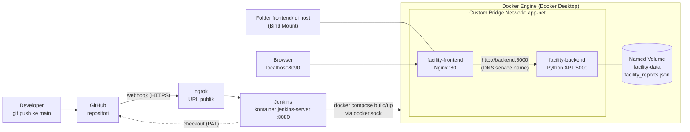

# Laporan Kerusakan Fasilitas Kampus (Facility Issue Reporting)

Proyek UTS (Ujian Chunin) mata kuliah **Cloud Computing**, Telkom University.
Aplikasi web fullstack sederhana untuk mencatat aduan kerusakan fasilitas kelas (AC mati, proyektor rusak, dan lainnya),
dijalankan dengan Docker Compose dan di-deploy otomatis oleh Jenkins setiap ada `git push` ke branch `main`.

## Anggota Kelompok

| No | Nama | NIM | Peran |
|---|---|---|---|
| 1 | Yohannes Novensius Sirait | 101012300348 | DevOps (Jenkins, GitHub, dll) |
| 2 | Dimas Reza Maulana | 101012300108 | FrontEnd |
| 3 | Putri Ardelia Nafisa | 101012300181 | BackEnd |
| 4 | Yulya Rahayu Sidabutar | 101012330286 | DevOps (Jenkins, GitHub, dll) |

**Studi kasus:** No. 8 - Laporan Kerusakan Fasilitas Kampus (Facility Issue Reporting)

## Arsitektur



| Komponen | Kontainer | Port host | Penyimpanan |
|---|---|---|---|
| Frontend (HTML + Vanilla JS di Nginx) | `facility-frontend` | 8090 | **Bind Mount** `./frontend` -> `/usr/share/nginx/html` |
| Backend (Python REST API) | `facility-backend` | 5050 | **Named Volume** `facility-data` -> `/var/lib/backend_data` |
| Jaringan | `app-net` (bridge) | - | Frontend memanggil backend lewat nama service `backend` |
| CI/CD | `jenkins-server` | 8080 | Volume `jenkins-data` |

Browser hanya berbicara dengan Nginx. Semua request `/api/...` diteruskan Nginx ke `http://backend:5000/...`
melalui DNS internal Docker, sehingga browser tidak perlu mengetahui alamat kontainer backend.

## Struktur Repositori

```
app.py                 Backend REST API (Python standard library, tanpa framework)
Dockerfile             Image backend (python:3.11-slim + HEALTHCHECK)
frontend/index.html    Frontend HTML + Vanilla JS (fetch API)
nginx/default.conf     Konfigurasi Nginx: static file + reverse proxy /api -> backend
docker-compose.yml     Definisi stack: backend, frontend, app-net, facility-data
Jenkinsfile            Pipeline 5 stage: Checkout, Syntax Check, Build Image, Deployment, Health Check
jenkins/Dockerfile     Image Jenkins kustom (Python 3, Git, Docker CLI, buildx, Docker Compose)
scripts/               Skrip bantu: setup Jenkins, uji API, data immunity, cek arsitektur, uji webhook
docs/webhook-log.txt   Catatan uji webhook (diisi otomatis oleh scripts/uji-webhook.sh)
```

## Endpoint API

| Method | Path | Fungsi | Respon |
|---|---|---|---|
| GET | `/health` | Status layanan | 200 |
| GET | `/reports` | Daftar aduan | 200 |
| POST | `/reports` | Kirim aduan baru | 201, atau 400 jika data tidak valid / JSON rusak |
| DELETE | `/reports?index=X` | Hapus aduan yang sudah selesai | 200, 400 jika index kosong/bukan angka, 404 jika tidak ada |

Body `POST /reports`:

```json
{
  "pelapor": "Yohannes",
  "lokasi": "Gedung TULT Lt. 7 Ruang 0704",
  "fasilitas": "AC",
  "prioritas": "Tinggi",
  "deskripsi": "AC tidak dingin sejak pagi"
}
```

- `fasilitas`: `AC`, `Proyektor`, `Listrik`, `Kursi/Meja`, `Jaringan/WiFi`, `Kebersihan`, `Lainnya`
- `prioritas` (opsional, default `Sedang`): `Rendah`, `Sedang`, `Tinggi`

Data disimpan di file `facility_reports.json` di dalam Named Volume `facility-data`.

## Menjalankan Secara Lokal

Prasyarat: Docker Desktop (Engine running) dan Git Bash.

```bash
git clone https://github.com/USERNAME/facility-report-uts.git
cd facility-report-uts
docker compose up -d --build
```

Buka **http://localhost:8090**. Perintah berguna:

```bash
docker compose ps                     # status service
bash scripts/isi-data-contoh.sh       # isi 3 aduan contoh
bash scripts/uji-api.sh               # uji semua endpoint (200/201/400/404)
bash scripts/cek-arsitektur.sh        # bukti app-net, DNS service name, volume, bind mount
bash scripts/data-immunity.sh         # hapus paksa backend, data tetap ada
docker compose down                   # hentikan stack (data tetap di volume)
```

**Bind Mount:** ubah teks di `frontend/index.html`, simpan, lalu refresh browser. Perubahan langsung tampil tanpa rebuild image.

**Data Immunity:** `docker rm -f facility-backend` lalu `docker compose up -d backend`. Data aduan tetap ada karena tersimpan di Named Volume, bukan di lapisan kontainer.

## CI/CD dengan Jenkins

### 1. Jalankan Jenkins kustom

```bash
bash scripts/siapkan-jenkins.sh
```

Skrip ini membangun image `jenkins-cicd:lab` (Jenkins LTS + Python 3 + Docker CLI + Docker Compose),
lalu menjalankan kontainer `jenkins-server` di port 8080 dengan volume `jenkins-data` dan akses ke `/var/run/docker.sock`.
Buka http://localhost:8080 dan selesaikan setup awal (Install suggested plugins, buat akun admin).

### 2. GitHub Personal Access Token (classic)

GitHub > Settings > Developer settings > Personal access tokens > Tokens (classic) > Generate new token (classic).
Note `Jenkins CI/CD UTS Token`, expiration 30 hari, centang **repo** dan **admin:repo_hook**.
Simpan di Jenkins: Manage Jenkins > Credentials > System > Global > Add Credentials,
Kind **Username with password**, Username = username GitHub, Password = token, ID `github-pat-uts`.

### 3. Job Pipeline

New Item > `facility-report-pipeline` > Pipeline. Centang **GitHub hook trigger for GITScm polling**.
Pipeline script from SCM > Git > URL repositori > credential `github-pat-uts` > branch `*/main` > Script Path `Jenkinsfile`.

### 4. Webhook melalui ngrok

```bash
ngrok http 8080
```

GitHub repo > Settings > Webhooks > Add webhook:
Payload URL `https://<domain-ngrok>/github-webhook/`, Content type `application/json`, Just the push event, Active.

### 5. Tahapan Pipeline

| Stage | Isi |
|---|---|
| 1. Checkout | Mengambil kode dari GitHub memakai credential PAT |
| 2. Syntax Check | `py_compile app.py`, cek `index.html` memakai `fetch()`, validasi `docker compose config` |
| 3. Build Image | `docker compose build backend`, tag nomor build + commit SHA + latest |
| 4. Automated Deployment | `docker compose up -d --force-recreate` |
| 5. Health Check | Frontend memanggil `http://backend:5000/health` (DNS service name), uji `/api/reports` lewat Nginx, cek halaman, `nginx -t`, status HEALTHCHECK |

**Catatan teknis bind mount di Jenkins.** Jenkins berjalan di dalam kontainer, sehingga path workspace
`/var/jenkins_home/workspace/...` tidak dikenal oleh Docker Engine. Pada stage 4, Jenkinsfile mencari lokasi asli
workspace di dalam volume `jenkins-data` (`docker volume inspect`) dan mengirimkannya sebagai variabel `HOST_ROOT`
ke `docker-compose.yml`. Saat dijalankan manual dari laptop, `HOST_ROOT` kosong sehingga bind mount memakai folder proyek.

## Troubleshooting

| Gejala | Solusi |
|---|---|
| `port is already allocated` (8090/5050) | `docker ps`, hentikan kontainer yang memakai port tersebut, atau ubah `FRONTEND_PORT` / `BACKEND_PORT` |
| Halaman menampilkan "API tidak terjangkau" | `docker compose ps`, pastikan `facility-backend` berstatus Up; lihat `docker compose logs backend` |
| HTTP 502 di `/api/...` | Backend sedang mati atau baru dibuat ulang; tunggu beberapa detik |
| Webhook gagal (404 `ERR_NGROK_3200`) | Tunnel ngrok mati; jalankan ulang `ngrok http 8080` lalu Redeliver |
| Git Bash mengubah path `/var/run/...` | Jalankan `export MSYS_NO_PATHCONV=1` (skrip sudah melakukannya) |
